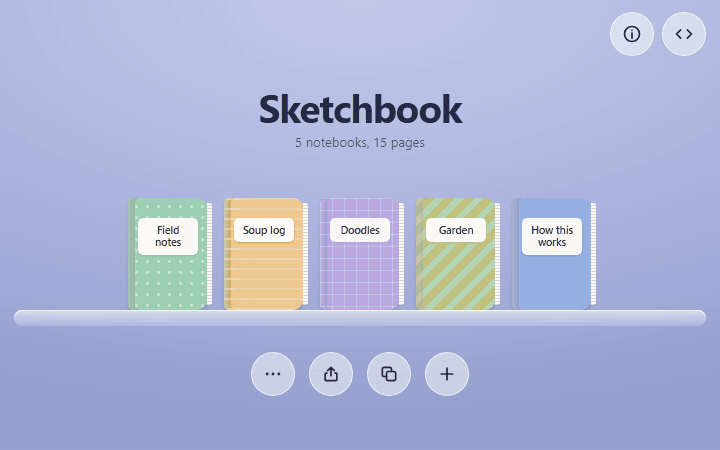
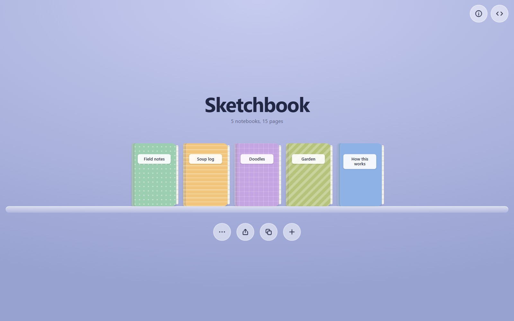
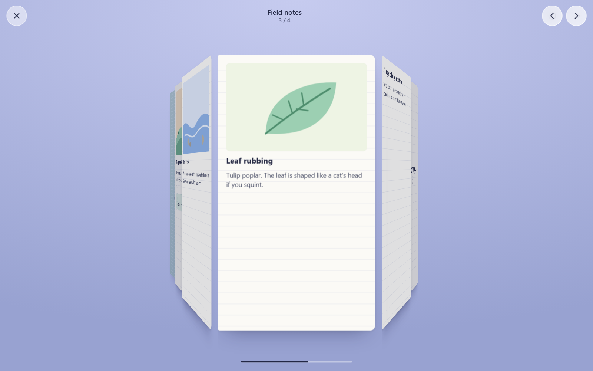
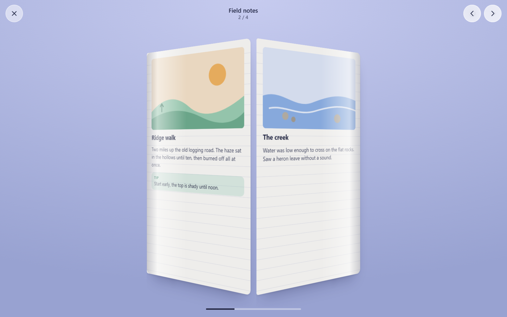

# Notebook Shelf

[](https://github.com/chasebuilds/notebook-shelf/actions/workflows/ci.yml)
[](https://chasebuilds.github.io/notebook-shelf/)

A shelf of notebooks that open in 3D. Tap a notebook and its pages fan out in a curved accordion you can drag, swipe or flip with the arrow keys. The last page signs off and the book closes back onto the shelf.

One script, no dependencies, no build step. Plain JavaScript and CSS 3D transforms, 37 KB (11.6 KB gzipped) with the styles included.

**Live demo: https://chasebuilds.github.io/notebook-shelf/**



| Shelf | Open | Half-turn |
|---|---|---|
|  |  |  |

## Quick start

Drop-in: one script tag and one div. The JSON can sit inside the div or come from a URL with `data-src`.

```html
<div data-notebook-shelf data-title="My shelf">
  <script type="application/json">
    [{ "id": "notes", "title": "Notes", "pages": [{ "title": "Hello", "text": "First page." }] }]
  </script>
</div>
<script src="notebook-shelf.js"></script>
```

From code:

```html
<div id="shelf"></div>
<script src="notebook-shelf.js"></script>
<script>
  const shelf = NotebookShelf.mount(document.getElementById('shelf'), notebooks, { title: 'Sketchbook' });
</script>
```

Copy `notebook-shelf.js` into your site, or load it from a pinned release tag, for example `https://cdn.jsdelivr.net/gh/chasebuilds/notebook-shelf@v1.0.0/notebook-shelf.js`.

## Data

```js
[
  {
    id: 'field-notes',                       // used by open('field-notes') and in events
    title: 'Field notes',
    subtitle: 'optional line under the big title',
    cover: { color: '#9ccfb2', pattern: 'dots', image: 'optional/cover.webp' }, // pattern: plain, dots, lines, grid, stripe
    pages: [
      {
        title: 'Ridge walk',
        text: 'Two miles up the old logging road.',
        image: { src: 'img/hills.webp', alt: 'Green hills', width: 320, height: 200 }, // or just a URL string
        note: 'Start early.', noteLabel: 'Tip',  // optional highlighted line
        links: [{ label: 'Repo', href: 'https://example.com', newTab: false }],
      },
    ],
  },
]
```

You can also pass `{ title, signoff, notebooks: [...] }` and the top-level fields become options. Colors are checked against a simple color pattern and `javascript:` and `data:` links are dropped. All text is set with `textContent`, so data can not inject HTML.

Each open book has a cover leaf first and a sign-off leaf last, so a notebook with 4 pages has 6 leaves.

## API

### `NotebookShelf.mount(element, data, options)`

Returns an instance. `element` can be a node or a selector. Mounting again on the same element replaces the old one.

| Option | Default | What it does |
|---|---|---|
| `title` | `'Notebooks'` | Big title over the shelf and the list's accessible name |
| `subtitle` | count of notebooks and pages | Small line under the title |
| `signoff` | `"ok, that's everything. bye for now :)"` | Text on the last leaf |
| `endButton` | `'Back to the shelf'` | Button on the last leaf |
| `hint` | `'Drag, swipe or use the arrow keys'` | Shown on the cover leaf and read to screen readers |
| `noteLabel` | `'Note'` | Default label for a page `note` |
| `unit` | `'page'` | Word used in counts, for example `'project'` gives "12 projects" |
| `actions` | `[]` | Round buttons under the shelf: `{ id, icon, label, onClick(shelf, event, button) }` |
| `topActions` | `[]` | Round buttons in the top bar, same shape |
| `window` | `3` | Pages kept in 3D on each side of the current one |
| `pageWidth` | `340` | Largest page width in px (pages shrink to fit the box) |
| `startPage` | `1` | Leaf to flip to after opening (`0` stays on the cover) |
| `reducedMotion` | follows the system | Force the reduced-motion path on or off |
| `injectCSS` | `true` | Set `false` if you ship `NotebookShelf.css` yourself |
| `onOpen`, `onClose`, `onPage` | none | Callbacks: `(notebook, shelf)` and `(page, notebook, shelf)` |

Built-in icons for actions: `more`, `share`, `copy`, `add`, `close`, `prev`, `next`, `list`, `code`, `info`, `book`. `NotebookShelf.icon(name)` returns the SVG string.

### Instance

| Member | What it does |
|---|---|
| `open(idOrIndex)` | Opens a notebook (returns a promise that resolves when the open animation ends) |
| `close()` | Flips back to the cover and puts the book back on the shelf |
| `next()`, `prev()`, `goTo(leaf)` | Flip. `next()` on the last leaf closes the book |
| `scrubTo(position)` | Places the pages at a fractional position, for custom controls |
| `setData(data)` | Replaces the notebooks while the shelf is showing |
| `toast(text)` | Shows a short status message (announced to screen readers) |
| `state` | `{ view, notebook, page, pages, position, reducedMotion, inThreeD, busy }` |
| `data` | The normalized notebooks |
| `destroy()` | Removes listeners and empties the element |

Events on the element: `notebookshelf:open`, `notebookshelf:close`, `notebookshelf:page` with `detail.notebook` and `detail.page`.

### Styling

Everything is under `.nbs`. Override these custom properties on the element:

`--nbs-height` (box height, default 580px), `--nbs-radius`, `--nbs-bg1` and `--nbs-bg2` (background gradient), `--nbs-ink`, `--nbs-ink2`, `--nbs-btn`, `--nbs-btn-hi`, `--nbs-edge`, `--nbs-shadow`, `--nbs-paper`, `--nbs-paper-ink`, `--nbs-rule`, `--nbs-focus`, `--nbs-cw` (cover width), `--nbs-gap`. Dark mode values switch with `prefers-color-scheme`.

## Keyboard and screen readers

- The shelf is a `<ul>` of `<button>` covers. Tab reaches them, Left and Right move between them, Enter or Space opens one.
- When a book opens, focus moves to the page area. Left and Right (or Page Up and Page Down) flip, Home and End jump, Escape closes. On close, focus goes back to that notebook's cover.
- Pages are an `<ol>`. Only the current page is reachable: the others get `inert` and `aria-hidden`, and a polite live region reads "Page 2 of 4: The creek" on each flip.
- Every icon button has an `aria-label`, icons are `aria-hidden`, and focus rings are visible.
- **Reduced motion:** if the system asks for less motion, there is no 3D at all. Pages swap with a 0.18 s fade, and opening and closing are 0.15 s fades.

## How the 3D works

The reader keeps one number, `position`, that can sit between pages while you drag. For every leaf it takes `d = leaf - position` and places the leaf with one CSS transform:

1. **Center leaf** (`d = 0`): flat and facing you.
2. **Neighbors** (`|d|` up to 1): each turns on a hinge at its inner edge, up to 68 degrees, so the pages fold away like an accordion. The hinge is done inside the transform (`translateX(hinge) rotateY(angle) translateX(-hinge)`), so no `transform-origin` changes per frame. Halfway between two pages, both leaves sit at 34 degrees and form an open spread.
3. **Lift:** a leaf in mid-turn moves toward you by `sin(pi * t)`, so it clears the stack behind it instead of cutting through it.
4. **Stack:** leaves further out keep the full fold, step outward a little and move back in depth, so their edges peek out at the sides.
5. **Shading:** each leaf has two overlays whose opacity follows the fold: a dark shade that grows as the page turns away, and a light band at the outer edge that peaks mid-turn to suggest a curl.

The parent has `perspective` and `transform-style: preserve-3d`, so the browser does the projection and depth sorting on the GPU. Dragging sets `position` directly; letting go eases it to the nearest page with an exponential step per frame (with a small fling from the release speed). Opening and closing are Web Animations on the book: it flies from the cover's on-screen box to the center (and back), while the shelf and reader cross-fade.

Performance rules the code follows:

- Only `transform` and `opacity` change during animation. The smoke test records every Web Animations keyframe and fails on anything else.
- Only leaves within `window` (3) of the current one are rendered in 3D and get `will-change`; the rest are `visibility: hidden` and never touched per frame.
- The per-frame code only writes inline styles. Focus, `inert`, image loading and announcements change only when the target page changes. Page images load and decode when they come within `window + 1` leaves, before they turn into view.

## Measured

From [`docs/MEASURED.md`](docs/MEASURED.md): headed Chromium on this repo's demo, 1280 x 800, vsync and the frame cap off, 5 seconds per scenario.

| Setup | Scenario | Frames per second | 95th percentile frame time |
|---|---|---:|---:|
| Desktop (Ryzen 5 7600X, RTX 5070) | scrubbing across all 6 leaves, new position every frame | 1,478 | 1.5 ms |
| Same | open and close loop | 1,709 | 1.4 ms |
| CPU slowed 4x with `Emulation.setCPUThrottlingRate` | scrubbing | 665 | 3.2 ms |
| Same | open and close loop | 1,037 | 1.5 ms |

The shelf's own code takes 0.03 ms per frame (0.07 ms with the CPU slowed 4x). Under 1% of frames took longer than 16.7 ms in every row. These numbers need an otherwise idle machine: with other programs holding the CPU at 100%, the same run dropped below 60 fps. Throttling slows script and layout, not the GPU, so it is a rough phone stand-in, not a phone. Rerun with `npm run measure`.

## Tests

`npm test` runs a headless Chromium smoke test (CI runs it on every push):

- the demo loads with no console errors, and the shelf is a real list of cover buttons
- a click opens a book at page 1 and focus moves inside it
- a mouse drag and a touch swipe both scrub pages; Left and Right flip
- the last leaf shows the sign-off, Right closes the book and focus returns to its cover
- keyboard only: Right moves between covers, Enter opens, Escape closes
- at most 9 leaves are in 3D at once, and animations touch only `transform` and `opacity`
- reduced motion: no 3D transforms, one page visible, keys still work
- 375 px wide: no sideways scroll on the shelf or in a book, reader buttons are at least 44 px
- buttons and links have names, images have `alt`, ids are unique
- the one-script drop-in mounts from inline JSON

Other scripts: `npm run serve` (local server on port 4173), `npm run measure`, `npm run screenshots` (needs ffmpeg).

## License

MIT

## More from Chase Builds

- **[dither-pond](https://github.com/chasebuilds/dither-pond)**: A stylized 3D scene with a day-to-night slider and a mix of animals, boat, bike, wind and water. ([live demo](https://chasebuilds.github.io/dither-pond/))
- **[liquid-logo-studio](https://github.com/chasebuilds/liquid-logo-studio)**: Turns any logo into animated liquid chrome or gold, ready to export or embed. ([live demo](https://chasebuilds.github.io/liquid-logo-studio/))
- **[window-hero](https://github.com/chasebuilds/window-hero)**: Your homepage becomes a window: the 3D scene shifts as the visitor moves. Camera optional and on-device only. ([live demo](https://chasebuilds.github.io/window-hero/))

[All projects, sorted by industry](https://github.com/chasebuilds) · [chasebuilds.github.io](https://chasebuilds.github.io)
